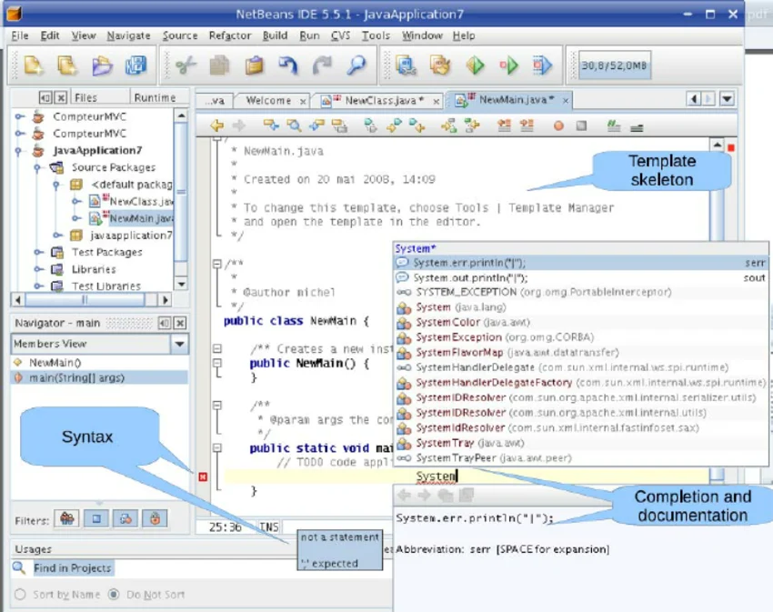

# Pengenalan JDBC

<!-- Kolom Teks / Penjelasan -->

<h3 class="text-base font-bold text-blue-400 mb-1">Definisi</h3>
<b>Netbeans</b> adalah Integrated Development Environment (IDE) atau perangkat lunak yang menyediakan fasilitas penulisan kode untuk bahasa Java. 

Jika ibaratnya kode yang kita tulis adalah kata-kata dalam cerita, maka Netbeans adalah platform Microsoft Word / Google Docs yang kita pakai untuk menulis cerita tersebut.

<h3 class="text-base font-bold text-emerald-400 mb-1">IDE ≠ Framework</h3>
Netbeans bukanlah <b>framework</b> yang menyediakan kerangka kode untuk membangun aplikasi <i>(Laravel, React).</i>

Netbeans hanya menyediakan alat-alat yang diperlukan untuk menulis kode yang dibuat, seperti Code Editor, Compiler, dan Debugger. 

<!-- Kolom Gambar (Kanan) -->

    

