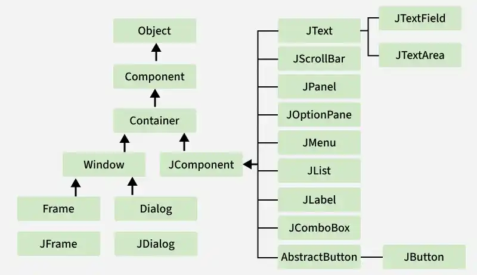

# Swing Hierarchy

Komponen-komponen inti dalam GUI, seperti JFrame, JButton, JTextField, JProgressBar, dan sebagainya meng-inherit sifat-sifat dari <i>base classes</i> seperti Container dan JComponent.

    

