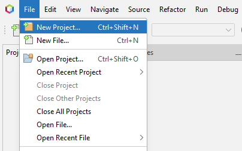
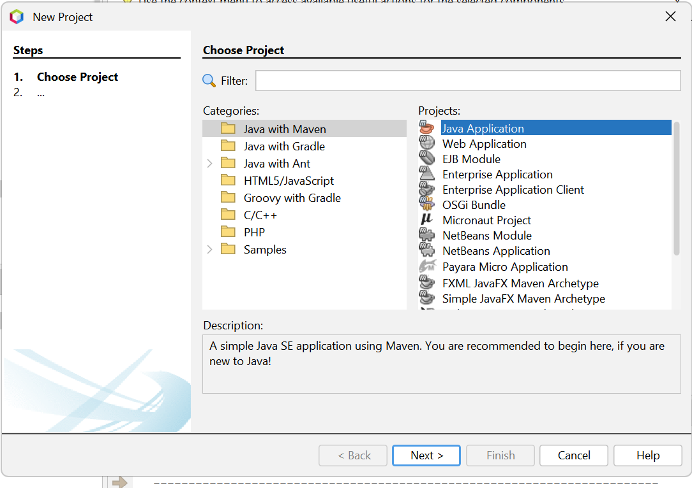

# Implementasi Swing (Aplikasi Hitung Nilai Akhir Mahasiswa)

<!-- Kolom 1 (Kiri) -->

    <!-- Teks Instruksi -->
    

        <h3 class="text-base font-bold text-orange-400 mb-2">1. Buat Project Baru</h3>
        Pilih menu <b>File > New Project</b> di Netbeans.
    

    <!-- Placeholder Gambar -->
    

        
    

<!-- Kolom 2 (Kanan) -->

    <!-- Teks Instruksi -->
    

        <h3 class="text-base font-bold text-orange-400 mb-2">2. Pilih Project</h3>
        Pada kategori, pilih <b>Java with Maven</b>, kemudian pilih <b>Java Application</b>. Klik <b>Next</b>.
    

    <!-- Placeholder Gambar -->
    

        
    

