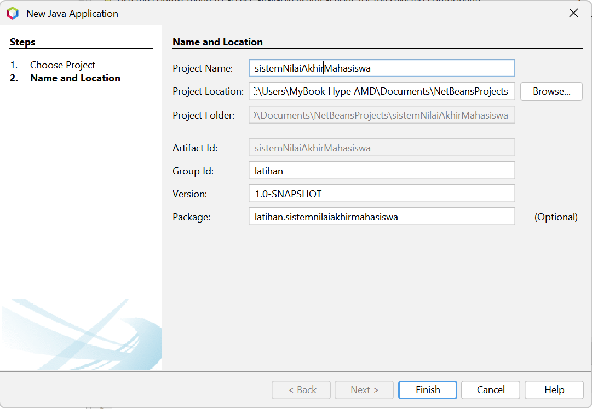
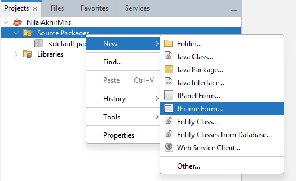

# Implementasi Swing

<!-- Kolom 1 (Kiri) -->

    <!-- Teks Instruksi -->
    

        <h3 class="text-base font-bold text-orange-400 mb-2">3. Buat Nama Project</h3>
        Ketikkan nama project (bebas) dan pilih Project Location sesuai keinginan. <i>Uncheck</i> kotak <b>Create Main Class</b> jika tidak ingin membuat main class default.
    

    <!-- Placeholder Gambar -->
    

        
    

<!-- Kolom 2 (Kanan) -->

    <!-- Teks Instruksi -->
    

        <h3 class="text-base font-bold text-orange-400 mb-2">4. Buat JFrame Form</h3>
        Setelah project terbentuk, klik kanan pada <b>Source Packages.</b> Klik <b>New > JFrame Form.</b>
    

    <!-- Placeholder Gambar -->
    

        
    

