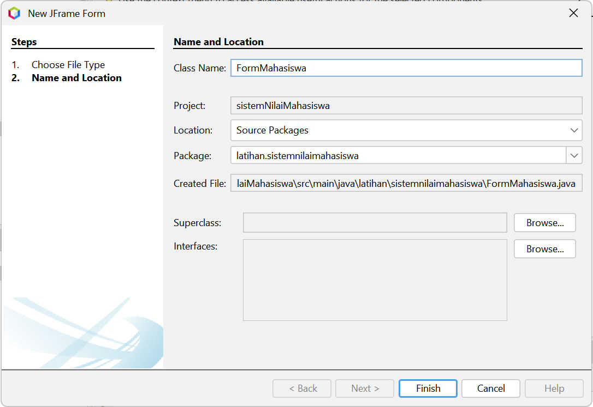
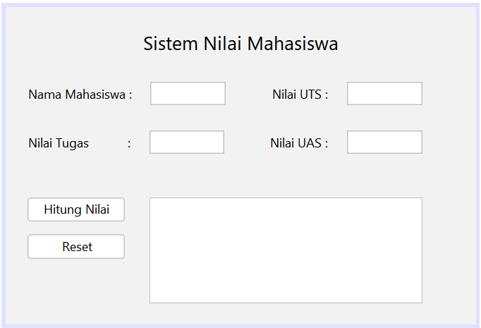

# Implementasi Swing

<!-- Kolom 1 (Kiri) -->

    <!-- Teks Instruksi -->
    

        <h3 class="text-base font-bold text-orange-400 mb-2">5. Nama Kelas Form</h3>
        Ketikkan nama kelas untuk form yang akan dibuat (bebas). Klik <b>Finish</b> jika sudah selesai.
    

    <!-- Placeholder Gambar -->
    

        
    

<!-- Kolom 2 (Kanan) -->

    <!-- Teks Instruksi -->
    

        <h3 class="text-base font-bold text-orange-400 mb-2">6. Masukkan Komponen</h3>
        Dengan <b>Palette</b> yang ada di sebelah kanan Netbeans, buatlah 5 <b>JLabel</b> ("Nama Mahasiswa", "Nilai Tugas", "Nilai UTS", "Nilai UAS", "Title"). Buatlah juga 4 <b>JTextField</b> dan 2 <b>JButton</b> ("Hitung Nilai" dan "Reset"). Terakhir, buat 1 Text Area
    

    <!-- Placeholder Gambar -->
    

        
    

