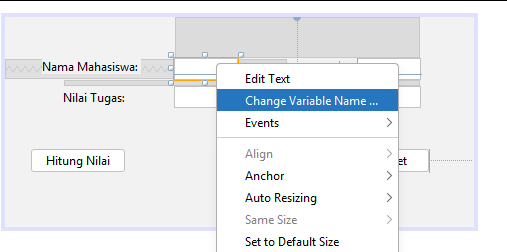
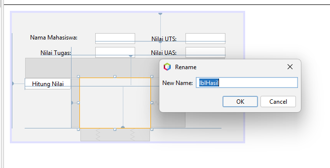

# Implementasi Swing

<!-- Kolom 1 (Kiri) -->

    <!-- Teks Instruksi -->
    

        <h3 class="text-base font-bold text-orange-400 mb-2">7. Ganti Nama Variabel</h3>
        Ganti nama variabel untuk semua text field dan button serta JLabel5. Klik kanan pada komponen tersebut dan pilih <b>Change Variable Name</b>.
    

    <!-- Placeholder Gambar -->
    

        
    

<!-- Kolom 2 (Kanan) -->

    <!-- Teks Instruksi -->
    

        <h3 class="text-base font-bold text-orange-400 mb-2">8. Masukkan Nama Komponen Baru</h3>
        Tentukan nama-nama komponen baru menjadi <b>txtNama, txtTugas, txtUts, txtUas, btnHitung, btnReset, dan lblHasil.</b>
    

    <!-- Placeholder Gambar -->
    

        
    

