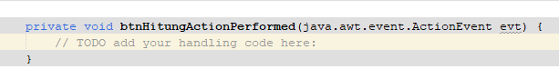

# Implementasi Swing

<div class="grid grid-cols-2 gap-8 mt-6">

<!-- Kolom 1 (Kiri) -->
<div class="flex flex-col space-y-4">
    <!-- Teks Instruksi -->
    <div class="text-[0.9rem] leading-normal">
        <h3 class="text-base font-bold text-orange-400 mb-2">9. Event Handler Tombol Hitung</h3>
        Double-click tombol Hitung Nilai pada mode <i>Design</i> dan Netbeans akan otomatis pindah ke mode <i>Source</i> pada blok method <b>btnHitungActionPerformed</b>. 
    </div>
    <!-- Placeholder Gambar -->
    <div class="flex justify-center flex-grow">
        
    </div>
</div>

<!-- Kolom 2 (Kanan) -->
<div class="flex flex-col space-y-4">
    <!-- Teks Instruksi -->
    <div class="text-[0.9rem] leading-normal">
        <h3 class="text-base font-bold text-orange-400 mb-2">10. Masukkan Kode Hitung Nilai</h3>
        Salin dan masukkan kode berikut ke blok method <b>btnHitungActionPerformed</b>:
    </div>
    <!-- Placeholder Kode -->
    <div class="flex justify-center flex-grow">

```java
try {
            String nama = txtNama.getText();
            if(nama.isEmpty()){
                javax.swing.JOptionPane.showMessageDialog(this, "Nama tidak boleh kosong!");
                return; 
            }

            double nilaiTugas = Double.parseDouble(txtTugas.getText());
            double nilaiUts = Double.parseDouble(txtUts.getText());
            double nilaiUas = Double.parseDouble(txtUas.getText());

            double nilaiAkhir = (nilaiTugas * 0.3) + (nilaiUts * 0.3) + (nilaiUas * 0.4);

            String grade;
            if (nilaiAkhir >= 80) grade = "A";
            else if (nilaiAkhir >= 70) grade = "B";
            else if (nilaiAkhir >= 60) grade = "C";
            else if (nilaiAkhir >= 50) grade = "D";
            else grade = "E";

            lblHasil.setText("<html>Mahasiswa: <b>" + nama + "</b> | Nilai Akhir: <b>" 
                    + nilaiAkhir + "</b> | Grade: <b>" + grade + "</b></html>");

        } catch (NumberFormatException e) {
            javax.swing.JOptionPane.showMessageDialog(this, "Masukkan angka yang valid untuk nilai!");
        }
```

</div>
</div>

</div>