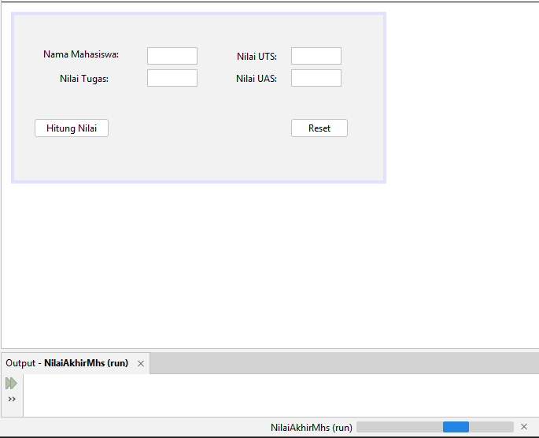

# Implementasi Swing

<div class="grid grid-cols-2 gap-8 mt-6">

<!-- Kolom 1 (Kiri) -->
<div class="flex flex-col space-y-4">
    <!-- Teks Instruksi -->
    <div class="text-[0.9rem] leading-normal">
        <h3 class="text-base font-bold text-orange-400 mb-2">11. Masukkan kode Reset</h3>
        Double-click tombol <b>Reset</b> pada mode <i>Design</i> dan masukkan kode berikut ke blok method <b>btnResetActionPerformed</b>:
    </div>
    <!-- Placeholder Kode -->
<div class="flex justify-center flex-grow">
        
```java
txtNama.setText("");
        txtTugas.setText("");
        txtUts.setText("");
        txtUas.setText("");
        lblHasil.setText("");

        txtNama.requestFocus();
```
  
</div>
</div>

<!-- Kolom 2 (Kanan) -->
<div class="flex flex-col space-y-4">
    <!-- Teks Instruksi -->
    <div class="text-[0.9rem] leading-normal">
        <h3 class="text-base font-bold text-orange-400 mb-2">12. Jalankan Program</h3>
        Tekan tombol shortcut keyboard <b>Shift + F6</b> (atau <b>Shift + Fn + F6</b>) untuk menjalankan kode. Kalian juga bisa klik kanan pada mode <i>Source</i> dan klik <b>Run File</b>.
    </div>
    <!-- Placeholder Gambar -->
    <div class="flex justify-center flex-grow">
        
    </div>
</div>

</div>