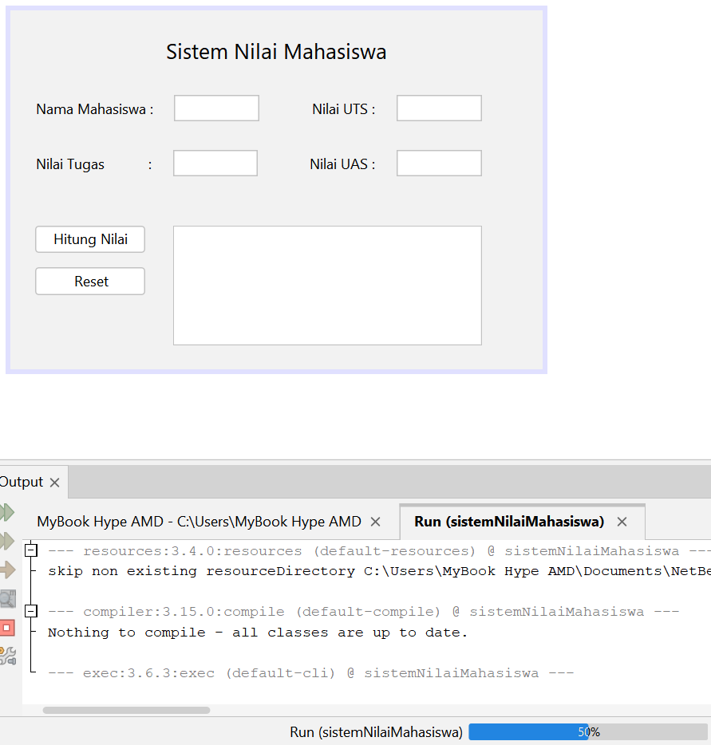
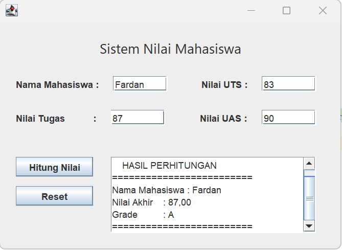

# Implementasi Swing

<!-- Kolom 1 (Kiri) -->

    <!-- Teks Instruksi -->
    

        <h3 class="text-base font-bold text-orange-400 mb-2">13. Jalankan Program</h3>
        Tekan tombol shortcut keyboard <b>Shift + F6</b> (atau <b>Shift + Fn + F6</b>) untuk menjalankan kode. Kalian juga bisa klik kanan pada mode <i>Source</i> dan klik <b>Run File</b>.
    

    <!-- Placeholder Gambar -->
    

        
    

<!-- Kolom 2 (Kanan) -->

    <!-- Teks Instruksi -->
    

        <h3 class="text-base font-bold text-orange-400 mb-2">14. Tes Aplikasi</h3>
        Masukkan nama mahasiswa dan 3 nilai tugas, UTS, dan UAS ke dalam textField. Lihat apakah logika program sudah berjalan dengan benar (output sudah sesuai).
    

    <!-- Placeholder Gambar -->
    

        
    

