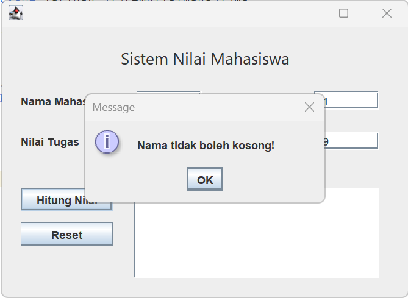
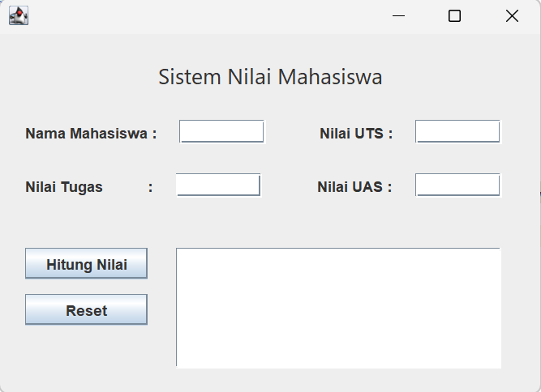

# Implementasi Swing

<!-- Kolom 1 (Kiri) -->

    <!-- Teks Instruksi -->
    

        <h3 class="text-base font-bold text-orange-400 mb-2">15. Uji Coba Validasi</h3>
        Uji coba semua validasi inputan yang sudah dibuat seperti mengosongkan field nama mahasiswa.
    

    <!-- Placeholder Gambar -->
    

        
    

<!-- Kolom 2 (Kanan) -->

    <!-- Teks Instruksi -->
    

        <h3 class="text-base font-bold text-orange-400 mb-2">16. Uji Tombol Reset</h3>
        Uji coba tombol Reset yang dibuat. Semua textField dan label output akan dibersihkan dan fokus cursosr akan kembali ke textField untuk nama mahasiswa.
    

    <!-- Placeholder Gambar -->
    

        
    

