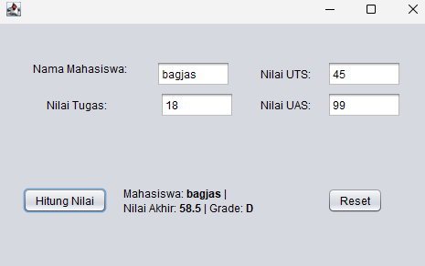
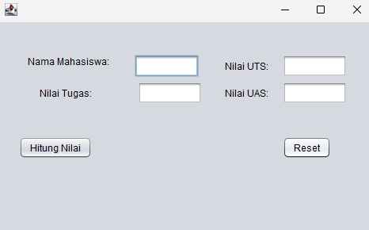

# Implementasi Swing

<!-- Kolom 1 (Kiri) -->

    <!-- Teks Instruksi -->
    

        <h3 class="text-base font-bold text-orange-400 mb-2">13. Uji Coba Aplikasi GUI</h3>
        Masukkan nama mahasiswa dan 3 nilai tugas, uts, dan uas ke dalam textField. Uji coba semua validasi inputan, seperti memasukkan huruf ke textField angka atau memasukkan angka di luar range 0-100.
    

    <!-- Placeholder Gambar -->
    

        
    

<!-- Kolom 2 (Kanan) -->

    <!-- Teks Instruksi -->
    

        <h3 class="text-base font-bold text-orange-400 mb-2">14. Uji Tombol Reset</h3>
        Setelah output dari inputan sebelumnya keluar, uji coba tombol Reset yang dibuat. Semua textField dan label output akan dibersihkan dan fokus cursosr akan kembali ke textField untuk nama mahasiswa.
    

    <!-- Placeholder Gambar -->
    

        
    

